<p align="center">
  
</p>

<p align="center">
  <a href="https://www.linkedin.com/in/zolboo-o/"></a>
  <a href="https://www.instagram.com/zolboooktybri/"></a>
  <a href="https://www.facebook.com/zolboo.oktybr/"></a>
  <a href="https://github.com/soulforger1?tab=repositories"></a>
</p>

---

### `> cat about.ts`

```ts
const zolboo = {
  role: "Full-stack developer",
  builds: ["web apps", "iOS & Android apps", "APIs & backends"],
  codingSince: 2020,
  origin: "C++ & competitive programming",
  web: ["React", "Next.js", "Vite", "Tailwind"],
  backend: ["NestJS", "Hono", "GraphQL", "Django", "Cloudflare Workers"],
  mobile: ["Expo / React Native", "SwiftUI", "Kotlin"],
  data: ["PostgreSQL", "Prisma", "Drizzle", "Redis"],
  pairProgrammer: "Claude Code",
  forFun: "solving algorithm problems",
  askMeAbout: "anything, really. Happy to help 🤝",
};
```

### `> ls ./toolbox`

<table>
  <tr>
    <td><b>Languages</b></td>
    <td></td>
  </tr>
  <tr>
    <td><b>Frontend</b></td>
    <td></td>
  </tr>
  <tr>
    <td><b>Backend</b></td>
    <td></td>
  </tr>
  <tr>
    <td><b>Data</b></td>
    <td></td>
  </tr>
  <tr>
    <td><b>Cloud &amp; DevOps</b></td>
    <td></td>
  </tr>
  <tr>
    <td><b>Testing &amp; tools</b></td>
    <td></td>
  </tr>
  <tr>
    <td><b>Mobile</b></td>
    <td>    </td>
  </tr>
  <tr>
    <td><b>Libraries</b></td>
    <td>        </td>
  </tr>
  <tr>
    <td><b>Monorepos &amp; auth</b></td>
    <td>   </td>
  </tr>
  <tr>
    <td><b>AI</b></td>
    <td>   </td>
  </tr>
</table>

### `> git log --graph`

<picture>
  <source media="(prefers-color-scheme: dark)" srcset="https://raw.githubusercontent.com/soulforger1/soulforger1/output/github-snake-dark.svg" />
  <source media="(prefers-color-scheme: light)" srcset="https://raw.githubusercontent.com/soulforger1/soulforger1/output/github-snake.svg" />
  
</picture>

---

<p align="center">
  <sub>Want to build something together? <a href="https://www.linkedin.com/in/zolboo-o/">Message me on LinkedIn</a>.</sub>
</p>
